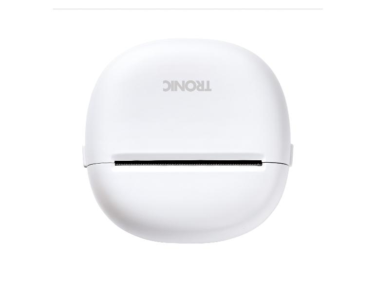
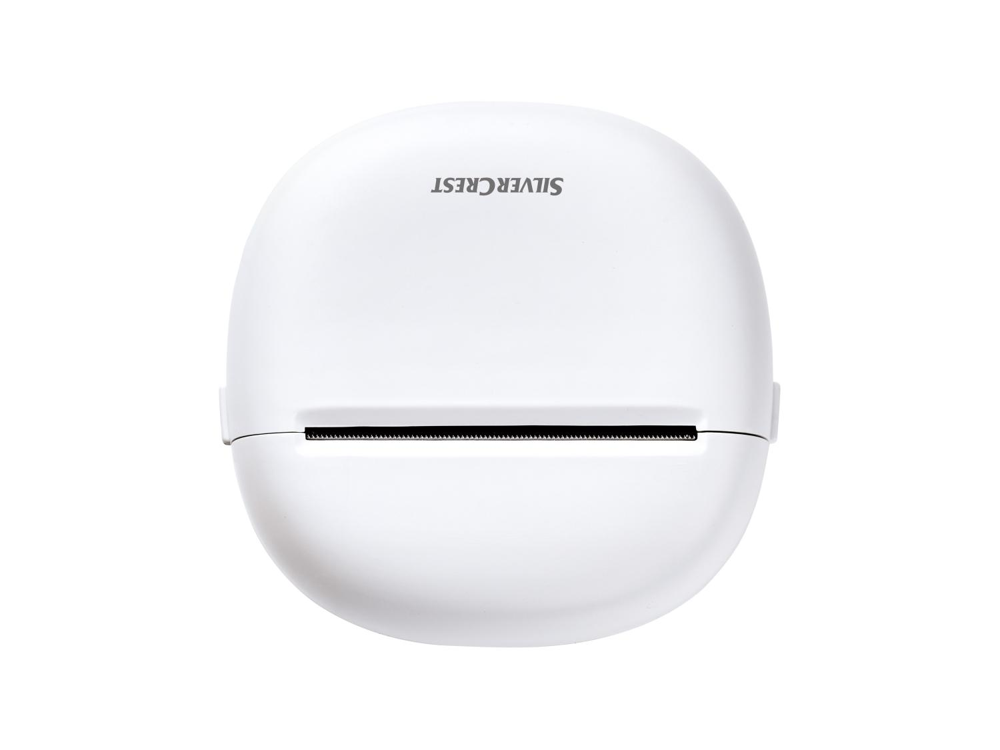
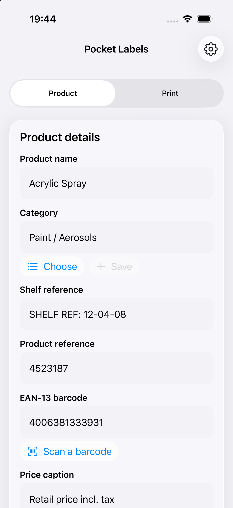
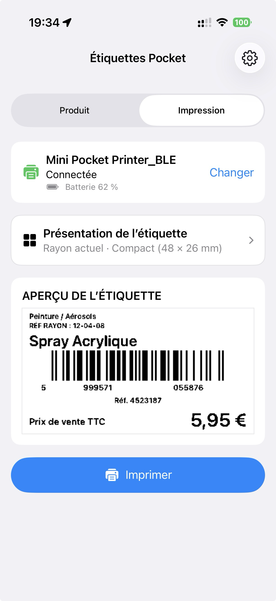

# ProductLabel5890

*[Version française](README_FR.md)*

**Pocket Labels** (French: **Étiquettes Pocket**) is a native iPhone app for creating product price labels and printing them directly over Bluetooth Low Energy to a Pocket Printer 5890. No AirPrint, image export, account, or internet connection is needed after installation.

| TRONIC | SILVERCREST |
|---|---|
|  |  |

| Product editor | Label preview and print |
|---|---|
|  |  |

## What the app does

Enter a product name, category, shelf reference, product reference, EAN‑13 barcode and price. The print screen shows the label using the same 1-bit bitmap sent to the printer. Connect to the 5890, then tap **Print**. The print button remains disabled when no printer is connected.

The app offers four label heights (about 26, 30, 39 and 52 mm) and six layouts. Settings include print density, paper feed before and after the label, and an optional 180° rotation of printed content. The preview remains upright when rotation is enabled. A calibration label helps check the actual paper output. The current product and print settings are restored on reopening; a local history stores the last 100 submitted print jobs with their layouts and settings for restoration or reprinting. The interface is available in English and French. Product names and saved category text stay as entered.

An EAN‑13 can be typed or scanned with the iPhone camera. Twelve digits get a calculated check digit; thirteen digits are validated. Categories can be entered freely or saved for later selection. Prices accept a comma or decimal point, with EUR, USD, GBP and CHF available.

## Printer and print format

The [PocketPrinter5890 project](https://github.com/dimer47/PocketPrinter5890) documents a physically tested 5890 with BLE model `A2Y` and firmware `V1.06LY`: **384 printable dots**, **48 bytes per row**, and a documented **203 dpi** resolution on approximately 56/58 mm continuous paper. The printable width is about 48 mm. These observations apply to the tested unit; other firmware may differ. The app always generates a 384-dot-wide bitmap for this printer. An 80 mm printer would require a separate hardware profile.

The four image heights are 208, 240, 312 and 416 dots. EAN‑13's 95 modules are drawn directly at three whole printer dots per module, with at least ten white modules of quiet zone on each side. There is no resize after rasterization. Text is composed at native resolution and thresholded to pure black or white at a fixed value of 160. No photo dithering is applied. The resulting monochrome bitmap goes straight to the 5890 protocol and BLE transport.

## Build and use

Use Xcode with an iOS SDK, an iPhone running iOS 17 or newer, and an Apple signing team for installation. Open `ProductLabel5890.xcodeproj`, select the `ProductLabel5890` scheme and your iPhone, set the signing team if needed, then run. Xcode resolves the Swift package dependency on the first build. The core tests run with `swift test`. A device build without signing can be checked with:

```sh
xcodebuild -project ProductLabel5890.xcodeproj -scheme ProductLabel5890 -configuration Debug -sdk iphoneos CODE_SIGNING_ALLOWED=NO build
```

1. Turn on the 5890 and iPhone Bluetooth.
2. Tap **Connect** and select the compatible printer, usually `Mini Pocket Printer_BLE`. The app looks for the last printer again on a later launch.
3. Fill in the **Product** form. Use **Scan a barcode** if you prefer the camera.
4. Open **Print**, choose a label presentation, inspect the preview, then tap **Print**.
5. In **Settings**, adjust density and paper feed or print the calibration label when needed.

The printer panel shows a battery percentage when the device reports one. A custom printer name is associated with that printer's Bluetooth identifier on this iPhone. No network connection is used to print.

## Code layout

| Path | Responsibility |
|---|---|
| `Sources/LabelCore` | Product data, presentation selection, EAN‑13 checks and patterns, price formatting, exact 1-bit rotation |
| `App/LabelRenderer.swift` | Native-resolution label layout and monochrome rasterization |
| `App/PrinterManager.swift` | Discovery, selection, reconnection, density and direct printing |
| `App/LabelHistoryStore.swift` | Local print history and restoration of print parameters |
| `App/ContentView.swift` | Editor, bitmap-based preview, printer status and settings |
| `PocketPrinter5890Kit` and `PocketPrinter5890BLE` | Swift package with 5890 commands, 24-row raster bands, flow control and CoreBluetooth transport |

See [label sizes](docs/FORMATS_PROPOSES.md) and [layout variants](docs/DISPOSITIONS_PROPOSEES.md) for the proposed presentations. The app uses its own native renderer; the Python mockups in those documents were used for visual exploration only.

## Known limits

The paper is continuous. Feed before printing defaults to 0 mm; feed after printing defaults to 104 dots, approximately 13 mm at the documented resolution. Paper visible above a cut label appears to come from the physical distance between the print head and tear edge; its exact size has not been measured. Check the total cut label height against a shelf label holder.

Print history records jobs submitted to the BLE transport, not a physical paper completion acknowledgement: the protocol does not provide one. Barcode scanning and switching among multiple rear camera lenses depend on the iPhone model and lighting. The available protocol documentation does not establish a tested immediate power-off command, so the app has no power-off button. Physical contrast, barcode readability, centering and cut position should be verified on each printer.

## License and attribution

ProductLabel5890 is under the [MIT License](LICENSE), copyright 2026 Dimitri Iachi. The [PocketPrinter5890](https://github.com/dimer47/PocketPrinter5890) Swift package is also MIT-licensed and retains its attribution and license in its own repository. The TRONIC and SILVERCREST photos above are reused from that repository with attribution under its MIT license. The project derives its Xcode setup and choice of BLE package from [PocketPrinter5890App](https://github.com/dimer47/PocketPrinter5890App), whose README also states MIT; that repository is unchanged.
