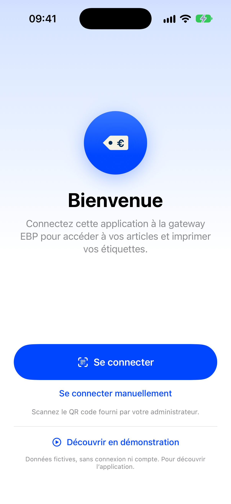
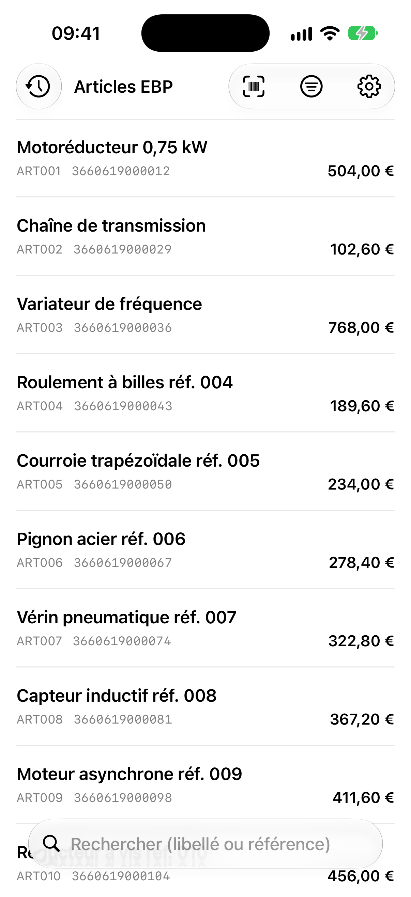
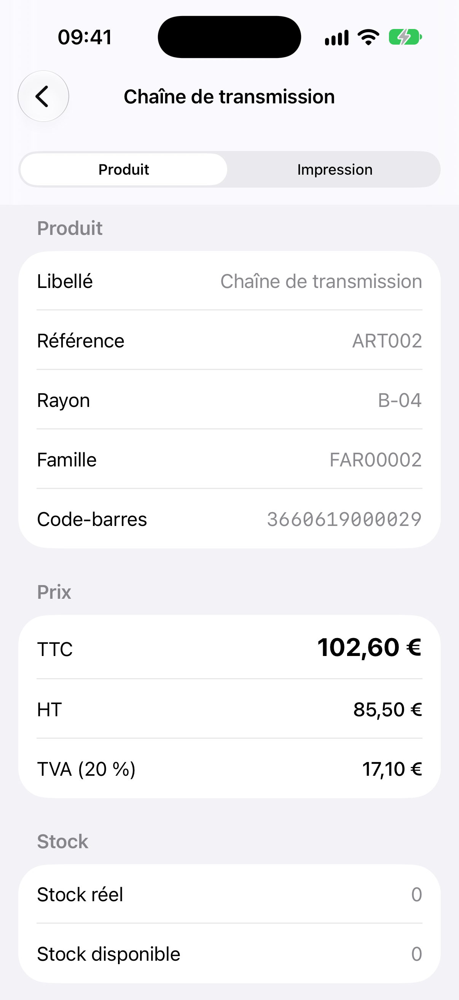
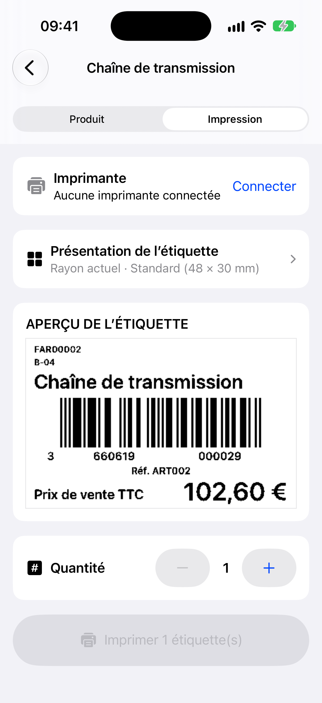
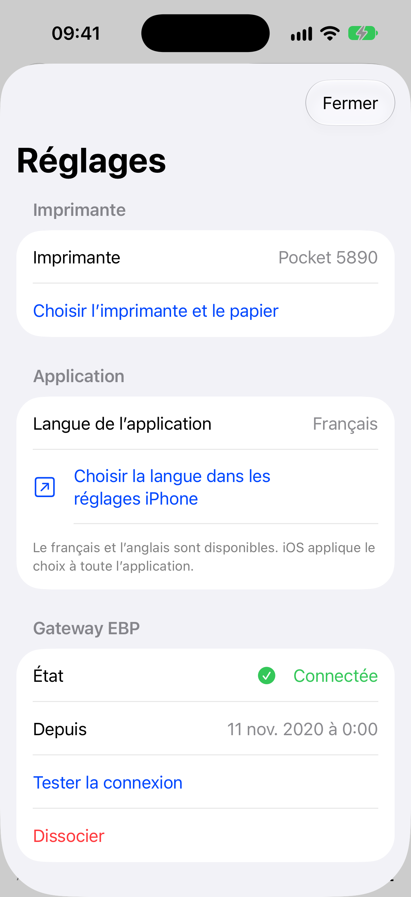

# Étiquettes EBP

*[Version française](README_FR.md)*

**Étiquettes EBP** is a native iPhone app that connects to an **EBP** gateway to browse your product catalog and print price labels in store, over Bluetooth. It is paired to the gateway with a QR code; no account setup is needed on the device.

| Welcome | Catalog | Product sheet | Print preview | Settings |
|---|---|---|---|---|
|  |  |  |  |  |

## What the app does

- **EBP catalog, live.** Browse every article from your EBP software: search by name or reference, filter by family, sub-family, price, availability and active state, and sort by reference, name or price. The list loads page by page for very large catalogs.
- **Rich product sheet.** Price incl. and excl. tax, VAT (amount and rate), real and available stock, shelf, family, supplier, logistics and EAN‑13 barcode.
- **Barcode scan.** Scan a barcode to find the matching article instantly, even if it is not in the loaded list yet.
- **Bluetooth printing.** Preview the label, choose the format and quantity, then print on a supported Bluetooth printer.
- **History.** Recently viewed articles and printed labels.
- **Demo mode.** Discover the app with fictitious data, with no account and no connection — useful for a demo or to try the app without a gateway.

The interface is available in English and French.

## Pairing with the EBP gateway

The app talks to an EBP gateway (a Laravel intermediation service, open source: [**gateway-for-ebp**](https://github.com/dimer47/gateway-for-ebp)). The administrator deploys the gateway, then generates a one-time pairing QR code from its back office; the app scans it, claims an application token (stored in the Keychain) and connects. The token is never embedded in the QR code. A manual connection (URL + token) is available as a fallback. For production, pairing requires HTTPS.

## Printing

Labels print over Bluetooth Low Energy on the supported thermal printers (Pocket 5890, Brother, NETUM NT-H861). The app renders the label itself as a 1‑bit bitmap — EAN‑13 barcode, price, reference — and sends it to the printer; no AirPrint, no image export, and no network connection is needed to print. Printer-specific notes are in [docs/NETUM_FR.md](docs/NETUM_FR.md) and [docs/BROTHER_FR.md](docs/BROTHER_FR.md) (French).

## Build and use

Use Xcode with an iOS SDK, an iPhone running iOS 17 or newer, and an Apple signing team for installation. Open `ProductLabels.xcodeproj`, select the `ProductLabels` scheme and your iPhone, set the signing team if needed, then run. Xcode resolves the Swift package dependency on the first build. The core tests run with `swift test`. A simulator build without signing can be checked with:

```sh
xcodebuild -project ProductLabels.xcodeproj -scheme ProductLabels -configuration Debug -sdk iphonesimulator CODE_SIGNING_ALLOWED=NO build
```

The app identifier is `com.idsynergy.ebp-tickets-prix` and the display name is **Étiquettes EBP**.

## Code layout

| Path | Responsibility |
|---|---|
| `Sources/LabelCore/GatewayClient.swift` | EBP gateway client: auth, whoami, articles query, 200/202 job polling |
| `Sources/LabelCore/EBPItem.swift`, `EBPProductMapper.swift` | EBP article decoding and mapping to a printable label + screen details |
| `Sources/LabelCore/GatewayWhereCondition.swift` | Search/filter condition builder (OData-like) |
| `Sources/LabelCore/PairingClient.swift` | QR pairing: claim a token from a one-time code |
| `Sources/LabelCore/DemoHTTPSession.swift` | Offline demo data source (no network) for review, screenshots and demos |
| `App/ProductListView.swift` | Root list: search, filters, sort, pagination, barcode scan |
| `App/ArticleDetailView.swift` | Product sheet (read-only) and print tab |
| `App/GatewaySettings.swift`, `KeychainToken.swift` | Gateway config, demo mode, token in the Keychain |
| `App/PairingView.swift`, `QRScannerView.swift` | Welcome/pairing screen and camera scanner |
| `Sources/LabelCore/LabelRenderer` + `App/PrinterManager.swift` | Native label rasterization and Bluetooth printing |

## License and attribution

Étiquettes EBP is source-available under the [PolyForm Noncommercial License 1.0.0](LICENSE), copyright 2026 Dimitri Iachi. Any noncommercial use — personal, internal, modifications, hobby projects — is permitted; **any commercial use** (reselling the software or a derivative, bundling it into a paid offering, or running a competing version) requires the licensor's prior written consent — contact <https://id-synergy.tech/#contact>. The [PocketPrinter5890](https://github.com/dimer47/PocketPrinter5890) Swift package keeps its own license and attribution in its own repository.

The Brother Print SDK in `Vendor/` belongs to Brother Industries and is under its own license ([`Vendor/Brother-SDK-EULA.pdf`](Vendor/Brother-SDK-EULA.pdf)); [`Vendor/Brother-SDK-Redist.txt`](Vendor/Brother-SDK-Redist.txt) allows redistribution of the files in the SDK `libs` folder. Brother and the model names are trademarks of Brother Industries; this project is neither affiliated with nor endorsed by Brother. EBP is a trademark of its owner; this project works with the EBP API but is not published or endorsed by EBP.
