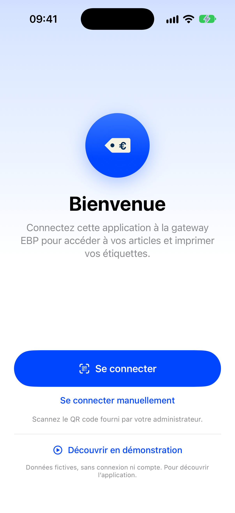
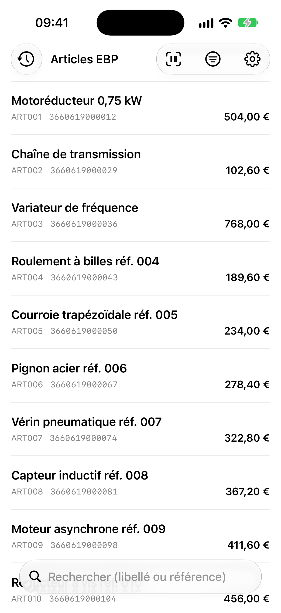
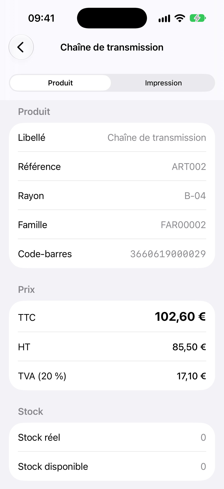
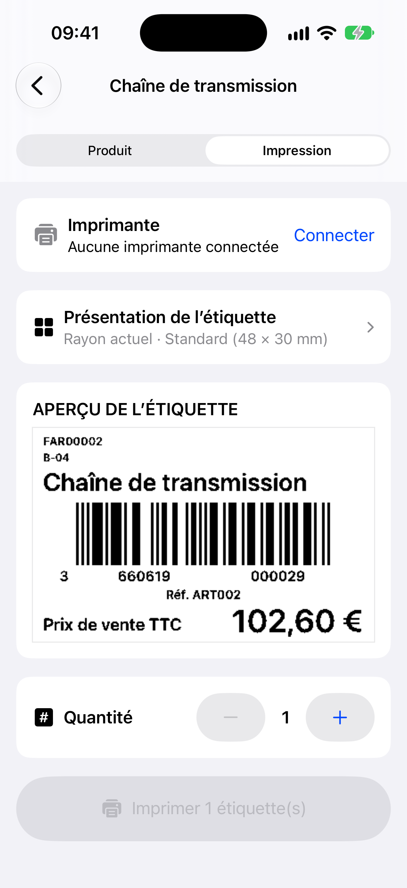
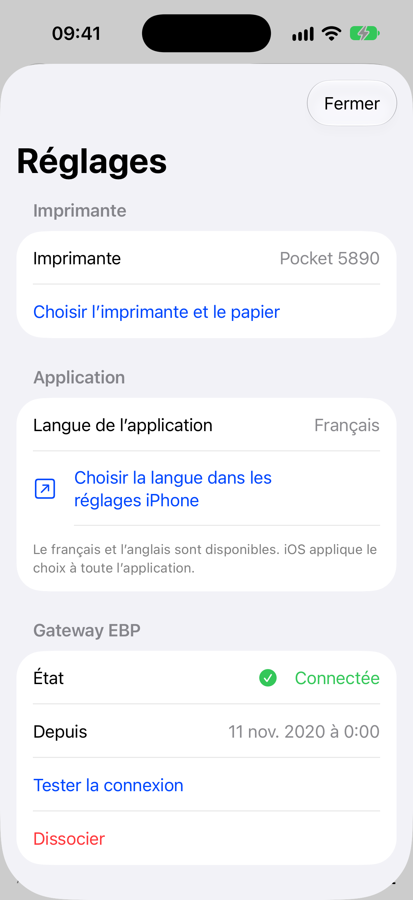

# Étiquettes EBP

*[English version](README.md)*

**Étiquettes EBP** est une application iPhone native qui se connecte à une gateway **EBP** pour consulter votre catalogue d'articles et imprimer des étiquettes de prix en magasin, en Bluetooth. L'appairage se fait par QR code ; aucune configuration de compte n'est nécessaire sur l'appareil.

| Accueil | Catalogue | Fiche article | Aperçu étiquette | Réglages |
|---|---|---|---|---|
|  |  |  |  |  |

## Ce que fait l'application

- **Catalogue EBP, en direct.** Parcourez tous les articles de votre logiciel EBP : recherche par libellé ou référence, filtres par famille, sous-famille, prix, disponibilité et état actif, tri par référence, libellé ou prix. La liste se charge page par page pour les très gros catalogues.
- **Fiche article complète.** Prix TTC et HT, TVA (montant et taux), stock réel et disponible, rayon, famille, fournisseur, logistique et code-barres EAN‑13.
- **Scan de code-barres.** Scannez un code pour retrouver instantanément l'article, même s'il n'est pas encore dans la liste chargée.
- **Impression Bluetooth.** Aperçu de l'étiquette, choix du format et de la quantité, puis impression sur une imprimante Bluetooth compatible.
- **Historique.** Articles consultés récemment et étiquettes imprimées.
- **Mode démonstration.** Découvrez l'application avec des données fictives, sans compte ni connexion — pratique pour une démo ou pour essayer l'application sans gateway.

L'interface est disponible en français et en anglais.

## Appairage avec la gateway EBP

L'application dialogue avec une gateway EBP (service d'intermédiation Laravel, open source : [**gateway-for-ebp**](https://github.com/dimer47/gateway-for-ebp)). L'administrateur déploie la gateway, puis génère depuis son back-office un QR code d'appairage à usage unique ; l'application le scanne, réclame un jeton d'application (stocké dans le trousseau) et se connecte. Le jeton n'est jamais encodé dans le QR code. Une connexion manuelle (URL + jeton) reste disponible en secours. En production, l'appairage exige le HTTPS.

## Impression

Les étiquettes s'impriment en Bluetooth Low Energy sur les imprimantes thermiques compatibles (Pocket 5890, Brother, NETUM NT-H861). L'application rend elle-même l'étiquette sous forme d'image 1 bit — code-barres EAN‑13, prix, référence — et l'envoie à l'imprimante ; aucun AirPrint, aucun export d'image, aucune connexion réseau n'est nécessaire pour imprimer. Les notes propres à chaque imprimante sont dans [docs/NETUM_FR.md](docs/NETUM_FR.md) et [docs/BROTHER_FR.md](docs/BROTHER_FR.md).

## Compiler et utiliser

Utilisez Xcode avec un SDK iOS, un iPhone sous iOS 17 ou plus récent, et une équipe de signature Apple pour l'installation. Ouvrez `ProductLabels.xcodeproj`, sélectionnez le schéma `ProductLabels` et votre iPhone, renseignez l'équipe de signature si besoin, puis lancez. Xcode résout la dépendance Swift au premier build. Les tests du cœur s'exécutent avec `swift test`. Un build simulateur sans signature se vérifie avec :

```sh
xcodebuild -project ProductLabels.xcodeproj -scheme ProductLabels -configuration Debug -sdk iphonesimulator CODE_SIGNING_ALLOWED=NO build
```

L'identifiant de l'application est `com.idsynergy.ebp-tickets-prix` et le nom affiché est **Étiquettes EBP**.

## Organisation du code

| Chemin | Rôle |
|---|---|
| `Sources/LabelCore/GatewayClient.swift` | Client de la gateway EBP : auth, whoami, requête d'articles, sondage de jobs 200/202 |
| `Sources/LabelCore/EBPItem.swift`, `EBPProductMapper.swift` | Décodage d'un article EBP et mapping vers une étiquette imprimable + détails écran |
| `Sources/LabelCore/GatewayWhereCondition.swift` | Constructeur de condition de recherche/filtre (OData-like) |
| `Sources/LabelCore/PairingClient.swift` | Appairage QR : réclamer un jeton à partir d'un code à usage unique |
| `Sources/LabelCore/DemoHTTPSession.swift` | Source de données de démo hors ligne (sans réseau) pour la revue, les captures et les démos |
| `App/ProductListView.swift` | Liste racine : recherche, filtres, tri, pagination, scan de code-barres |
| `App/ArticleDetailView.swift` | Fiche article (lecture seule) et onglet d'impression |
| `App/GatewaySettings.swift`, `KeychainToken.swift` | Config gateway, mode démo, jeton au trousseau |
| `App/PairingView.swift`, `QRScannerView.swift` | Écran d'accueil / appairage et scanner caméra |
| `Sources/LabelCore/LabelRenderer` + `App/PrinterManager.swift` | Rendu natif de l'étiquette et impression Bluetooth |

## Licence et attribution

Étiquettes EBP est à source ouverte sous [licence PolyForm Noncommercial 1.0.0](LICENSE), copyright 2026 Dimitri Iachi. Tout usage non commercial — personnel, interne, modifications, projets personnels — est autorisé ; **tout usage commercial** (revente du logiciel ou d'une œuvre dérivée, intégration dans une offre payante, ou exploitation d'une version concurrente) nécessite l'accord écrit préalable du titulaire — contact <https://id-synergy.tech/#contact>. Le paquet Swift [PocketPrinter5890](https://github.com/dimer47/PocketPrinter5890) conserve sa propre licence et son attribution dans son propre dépôt.

Le SDK Brother Print dans `Vendor/` appartient à Brother Industries et relève de sa propre licence ([`Vendor/Brother-SDK-EULA.pdf`](Vendor/Brother-SDK-EULA.pdf)) ; [`Vendor/Brother-SDK-Redist.txt`](Vendor/Brother-SDK-Redist.txt) autorise la redistribution des fichiers du dossier `libs` du SDK. Brother et les noms de modèles sont des marques de Brother Industries ; ce projet n'est ni affilié à Brother ni approuvé par lui. EBP est une marque de son propriétaire ; ce projet fonctionne avec l'API EBP mais n'est ni publié ni approuvé par EBP.
