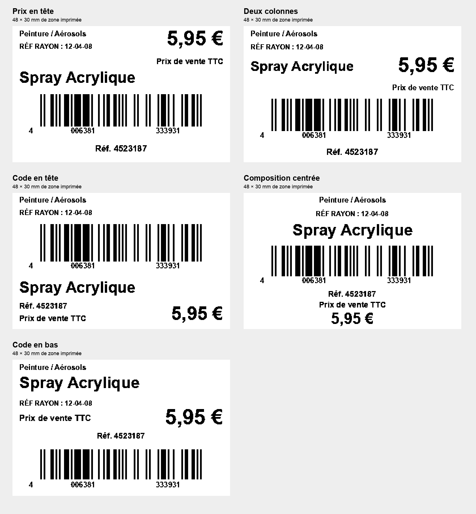

# Cinq dispositions, quatre hauteurs

Ces images servent à choisir une **disposition des mêmes informations**. Chaque proposition existe en Compact rayon (48 × 26 mm), Standard (48 × 30 mm), Rayon aéré (48 × 39 mm) et Grand (48 × 52 mm). Ces dimensions correspondent à la **zone bitmap imprimée**, pas à la longueur de papier après avance et découpe.

| Disposition | Principe | Voir les quatre hauteurs |
| --- | --- | --- |
| Prix en tête | Prix visible en premier, informations de rayon à côté, produit et code-barres dessous | [Aperçus](dispositions/prix_en_tete_quatre_formats.png) |
| Deux colonnes | Produit à gauche et prix à droite, code-barres sur toute la largeur sous l'en-tête | [Aperçus](dispositions/deux_colonnes_quatre_formats.png) |
| Code en tête | Code-barres juste après le rayon, puis nom, référence et prix | [Aperçus](dispositions/code_en_tete_quatre_formats.png) |
| Composition centrée | Composition verticale centrée, adaptée à une présentation symétrique | [Aperçus](dispositions/composition_centree_quatre_formats.png) |
| Code en bas | Nom et prix au-dessus, code-barres en dernière position | [Aperçus](dispositions/code_en_bas_quatre_formats.png) |

Toutes les maquettes contiennent la catégorie, la référence rayon, le nom, l'EAN-13 et ses chiffres, la référence produit, « Prix de vente TTC » et le prix. Le code `4006381333931` a un chiffre de contrôle valide. Chaque image d'étiquette est un bitmap strictement noir et blanc de **384 points de large** ; le code occupe 95 modules de 3 points et conserve des zones blanches latérales. Les planches agrandissent les images uniquement pour l'examen à l'écran.

Ces cinq dispositions et les quatre hauteurs sont maintenant disponibles dans l'application, à côté du modèle « Rayon actuel ». Les images ci-dessus restent des maquettes produites par [Tools/generate_layout_previews.py](../Tools/generate_layout_previews.py) (`python3 Tools/generate_layout_previews.py`, Pillow requis). Dans l'app, chaque miniature et l'aperçu principal proviennent du **moteur de rendu iOS utilisé pour l'impression**. Les 24 combinaisons doivent encore être contrôlées sur la 5890 physique, notamment la lecture de l'EAN et la hauteur du papier découpé.
