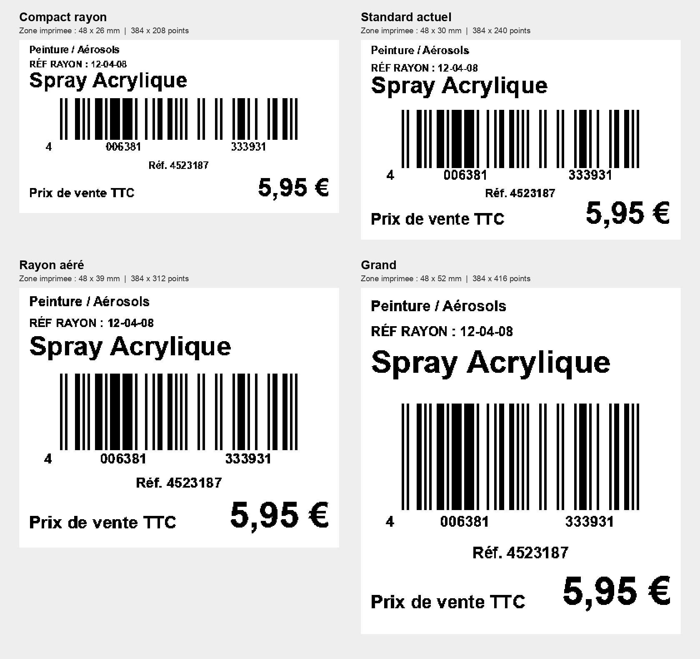

# Formats à valider avant implémentation

Tous les modèles reprennent exactement les mêmes champs : catégorie, référence rayon, nom, EAN-13, chiffres du code, référence produit, mention TTC et prix. Les dimensions ci-dessous sont celles du **bitmap imprimé**, pas celles du ticket après découpe.

Ces images sont des **maquettes monochromes de composition**, générées à 384 points de largeur avec un EAN-13 valide. Le format Standard reprend la hiérarchie de l'application actuelle, mais la typographie peut légèrement différer du moteur iOS. Les quatre fichiers à résolution native sont disponibles séparément : [Compact](formats/compact.png), [Standard](formats/standard.png), [Rayon aéré](formats/rayon_aere.png) et [Grand](formats/grand.png).

| Modèle | Bitmap sur la 5890 | Intention | Point à vérifier |
|---|---:|---|---|
| Compact rayon | 384 × 208 points ≈ 48 × 26 mm | Réduire la hauteur du contenu pour viser une petite réglette | Tous les champs restent présents ; le code-barres et le prix auront moins de hauteur. Scanner le code réel avant adoption. |
| Standard actuel | 384 × 240 points ≈ 48 × 30 mm | Conserver la mise en page déjà validée sur papier | Référence visuelle et de lisibilité. |
| Rayon aéré | 384 × 312 points ≈ 48 × 39 mm | Agrandir les textes, le code et le prix, avec plus d'espacement | Le ticket découpé dépassera 39 mm à cause des blancs mécaniques et des avances. |
| Grand | 384 × 416 points ≈ 48 × 52 mm | Affichage plus visible à distance, mêmes données | Plus de papier ; ne correspond pas à une réglette de 52 mm tant que le ticket découpé n'a pas été mesuré. |

La 5890 testée a une tête de **384 points**, soit environ **48 mm imprimables** sur rouleau de 56/58 mm. Changer la largeur déclarée du papier ne peut pas étendre cette tête. La largeur du code-barres actuel est de 345 points, quiet zones comprises (environ 43 mm) ; un modèle plus étroit demanderait de réduire les modules et une vérification au scanner.

Pour un **autre modèle d'imprimante 80 mm**, prévoir un profil matériel distinct avec largeur imprimable vérifiée, protocole de transport, caractéristiques BLE ou USB et essais physiques. À titre d'exemple seulement, une imprimante mobile 80 mm Star documente 72 mm/576 points : ce n'est pas une capacité établie pour la 5890. [Manuel Star SM-T300DB](https://www.starmicronics.com/support/Mannualfolder/sm-t300db_hm_en.pdf).

Avant de promettre une compatibilité avec une réglette de 39 ou 52 mm, mesurer sur un ticket découpé : blanc avant l'image + hauteur du bitmap + blanc après l'image. Les réglettes vendues pour rayonnage existent notamment en insertion de 26, 30, 39 et 52 mm. [VKF Renzel](https://www.vkf-renzel.com/gls-shelf-edge-strip-52-mm-transparent-20-0257-3.html).

**Décisions demandées :** choisir les modèles à implémenter en V1 et, pour le 80 mm, indiquer le modèle d'imprimante envisagé avant de concevoir son profil.
