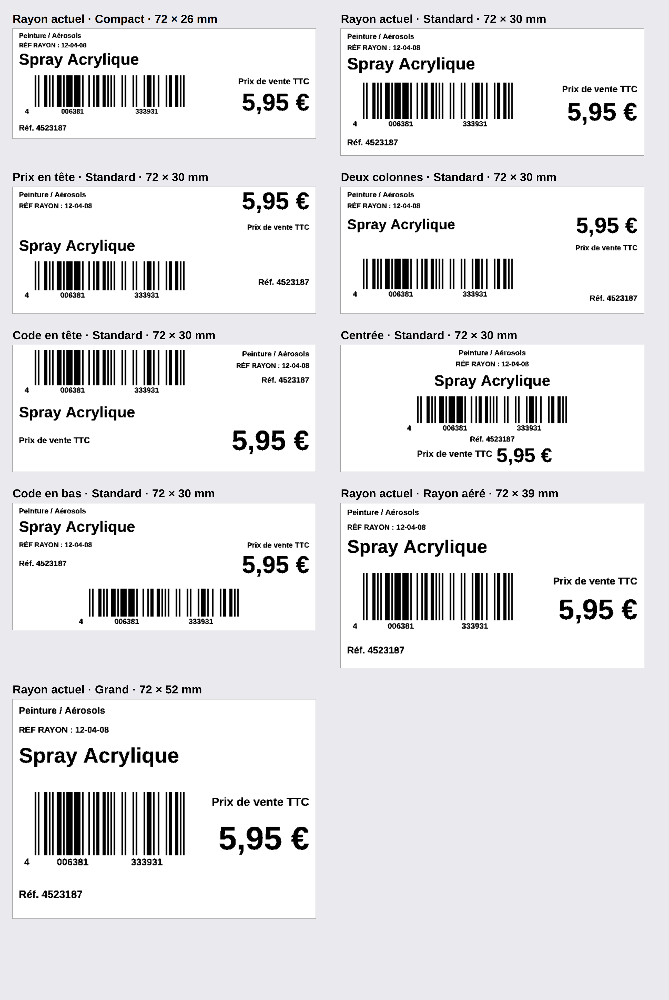

# NETUM NT-H861

Imprimante ticket 80 mm (tête de 576 points, 203 dpi), massicot, ESC/POS, en Bluetooth LE.

## Ce que fait l'app

- Connexion BLE depuis l'écran Imprimante (services `18F0` / `FFF0`, comme le SDK iOS NETUM)
- Rouleau 80 mm : six dispositions dédiées, 72 mm imprimables
- Rouleau 58 / 57 mm : dispositions de la 5890 (48 mm), décalage à gauche réglable
- Coupe totale, partielle ou aucune, après chaque exemplaire (`GS V 65/66 n`)
- Bip optionnel en fin d'impression (`ESC B n t`)
- Lecture de l'état avant impression (`DLE EOT 1…4`) : capot, papier, massicot
- Réglages Bluetooth : écriture avec accusé, pause entre paquets

Les commandes viennent du SDK iOS officiel NETUM, réécrites en Swift (`Sources/LabelCore/NetumPrinter.swift`).

## Dispositions 80 mm

Coordonnées dans `Sources/LabelCore/WideLabelLayout.swift`, vérifiées par les tests.

## À vérifier sur l'appareil

- L'imprimante apparaît en BLE sur l'iPhone
- La NETUM répond aux demandes d'état en BLE (sinon l'app imprime sans vérifier)
- Position du rouleau 58 mm sur la tête (réglage du décalage)
- Contraste et lecture du code-barres
